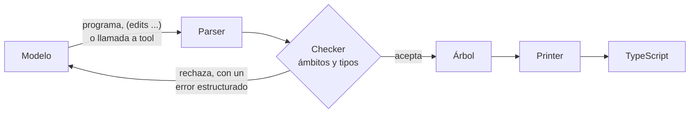

<div align="center">

<h1>Nodast</h1>

<p><strong>El modelo propone nodos. El printer escribe el código.</strong></p>

<p>Un formato de AST compacto para que un LLM edite código. El modelo edita un árbol tipado por id de nodo,<br>
cada edición se comprueba antes de existir como texto y un printer determinista escribe el TypeScript.</p>

<p>
  <a href="https://github.com/R4F405/Nodast/actions/workflows/ci.yml"></a>
  <a href="LICENSE"></a>
  
  
  <a href="rust/"></a>
  <a href="https://github.com/R4F405/Nodast/labels/good%20first%20issue"></a>
</p>

<p>
  <a href="#empezar">Empezar</a> ·
  <a href="#cómo-funciona">Cómo funciona</a> ·
  <a href="#resultados">Resultados</a> ·
  <a href="#límites">Límites</a> ·
  <a href="#roadmap">Roadmap</a> ·
  <a href="#contribuir">Contribuir</a> ·
  <a href="README.md">English</a>
</p>

</div>

<p align="center">
  <picture>
    <source media="(prefers-color-scheme: dark)" srcset="docs/demo.svg">
    <source media="(prefers-color-scheme: light)" srcset="docs/demo-light.svg">
    
  </picture>
  <br>
  <sub>Grabada con <code>pnpm demo</code>. Corre sin red: sin modelo y sin clave de API.</sub>
</p>

## Por qué

Los agentes de código editan texto. O reescriben el archivo entero, que es lento y caro en archivos grandes, o buscan y reemplazan cadenas, que falla cuando dos nombres se parecen (`rate` y `rate_cap`). Nada impide que una edición que no compila llegue al disco.

Nodast (**Node** + **AST**) le da al modelo un árbol en vez de un archivo:

- **Edita por id de nodo.** El modelo manda `(edits (replace n9 50))` o una llamada a una tool, no el archivo otra vez.
- **Se comprueba antes de escribirse.** Un parser y un checker de tipos Hindley-Milner rechazan una edición mala con un error estructurado que el modelo puede usar. Una edición rechazada no cambia nada.
- **Operaciones de estructura.** `rename` sigue los ámbitos. `param` añade un parámetro a una función y un argumento a cada llamada, en una sola edición.
- **Una sola salida.** El modelo nunca escribe el fuente final. Lo escribe un printer determinista.

> [!NOTE]
> **Medido con `gpt-6.1-sol` de OpenAI, 5 repeticiones por tarea:** el acierto es igual al del texto plano en todas las tareas. En un archivo de 500 líneas, una respuesta `(edits ...)` de un nodo tarda unos 2 s; que el modelo reescriba el archivo tarda 33 s. Frente a un agente de texto justo, con `grep`, `read` y `replace`, una edición local es un empate; renombrar respetando ámbitos es donde Nodast gana: 5/5 válido al primer intento frente a 1/5 en el caso pequeño, y entre 1.5 y 2 veces más rápido. [Todos los números](#resultados).

## Empezar

Hace falta **Node.js 22.18 o superior**, que ejecuta TypeScript directamente, así que no hay paso de compilación.

```sh
git clone https://github.com/R4F405/Nodast.git
cd Nodast
node src/demo.ts                   # la sesión de arriba: sin instalar, sin red, sin clave
node examples/check-and-print.ts   # parsear, comprobar, imprimir, editar por id y ver dos rechazos
node examples/model-loop.ts        # una respuesta rechazada vuelve al modelo y se corrige
```

Para los tests y la comprobación de tipos, instala las dos dependencias de desarrollo con [pnpm](https://pnpm.io) (el repo fija pnpm 11.5 en `packageManager`):

```sh
pnpm install
pnpm test                                   # sin red, sin clave
pnpm typecheck
cargo test --manifest-path rust/Cargo.toml  # el motor en Rust, con Rust estable
```

Para llamar a un modelo de verdad, copia `.env.example` a `.env` y pon una clave. `pnpm ask -- "bind the sum of 1 and 2"` le pide un programa a MiniMax; `pnpm bench` corre la medición, contra OpenAI por defecto.

## Cómo funciona



El modelo escribe S-expressions compactas:

```text
(let double (fn (n) (mul n 2)) (double 21))
```

El checker infiere `number` y el printer emite:

```ts
const double = (n) => n * 2;
double(21);
```

Para editar, el modelo ve el árbol con un id en cada nodo, `n1:(let double n2:(fn (n) n3:(mul n4:n n5:2)) n6:(n7:double n8:21))`, y lo cambia de una de estas tres formas:

| Forma | Qué manda el modelo | Sirve para |
| --- | --- | --- |
| Escribir | Un programa entero | Código nuevo |
| Editar por id | `(edits (replace n8 50) (insert id index expr) (delete id))` | Programas que caben enteros en el prompt |
| Tools | `find`, `show` y `edit` por function calling | Programas grandes y cambios de estructura |

`edit` puede hacer `replace`, `insert` o `delete` de un nodo, `rename` de un nombre con todos sus usos, o añadir un `param` a una función y a cada llamada. El checker corre primero, y si rechaza, el error vuelve al modelo. Un id que el modelo ya vio nunca vuelve en otro nodo.

Los tipos se infieren, así que el modelo nunca escribe anotaciones, y una función ligada con `let` es genérica. El mismo árbol, parser, checker, printer, operaciones y un formato binario plano también viven en Rust, en [`rust/`](rust/); TypeScript es la referencia de comportamiento.

<details>
<summary><strong>Decisiones de diseño</strong>, que no se reabren en un pull request sin una issue antes</summary>

1. El modelo no escribe el fuente final.
2. El modelo lee y escribe texto compacto. JSON, hexadecimal y el AST de otro compilador quedan fuera de ese contrato.
3. El binario es interno, de después del checker, no lo que el modelo emite.
4. Una edición cambia nodos por id. No se reescribe el archivo.
5. Nada llega al printer sin pasar el checker.
6. Un solo lenguaje de salida, TypeScript, hasta que el círculo pedido → árbol válido → código esté sólido.
7. Ni varios lenguajes fuente ni un ejecutor de bytecode en esta etapa.

</details>

## Resultados

`gpt-6.1-sol` de OpenAI, razonamiento `low`, 5 repeticiones por tarea. **Todas las variantes llegaron al resultado correcto en todas las repeticiones**, así que la tabla compara tiempo y tokens (entrada / salida). El agente de texto trabaja sobre el mismo archivo TypeScript con `grep`, `read` y `replace` (con reemplazar todo), como editan hoy los agentes de código.

| Tarea | Nodast, tools | Agente de texto, tools | El modelo reescribe el archivo |
| --- | ---: | ---: | ---: |
| Cambiar una constante en un archivo de 500 líneas | 4.6 s · 772 / 61 | **4.5 s · 581 / 67** | 32.8 s · 5559 / 5513 |
| Renombrar `rate` a `scale` junto a `rate_cap`, 40 pasos | **2.2 s**, 5/5 a la primera | 4.7 s, 1/5 a la primera | 4.7 s, 5/5 a la primera |
| El mismo renombrado, 400 pasos | **4.4 s · 907 / 55** | 6.7 s · 1187 / 80 | 29.1 s · 4975 / 4927 |
| Añadir un parámetro a una función llamada 200 veces¹ | **9.1 s · 2182 / 136** | 13.7 s · 12045 / 174 | 35 s · 7432 / 5668 |
| Escribir un programa pequeño desde cero, 12 objetivos | 1.9 s · 23 de salida, 60/60 | — | 2.1 s · 25 de salida, 60/60 |

Qué dice:

- **Una edición local es un empate** con un buen agente de texto. Lo que ahorra tokens es editar por partes, y ese agente también edita por partes.
- **Nodast gana en los cambios que tocan muchos sitios.** `rename` sigue los ámbitos, así que nunca toca `rate_cap`; el agente de texto suele reemplazar `rate` en todo el archivo, romper `rate_cap` y arreglarlo en una segunda llamada. `param` actualiza todas las llamadas en una edición; el agente de texto tiene que llegar a cada una.
- **Frente a reescribir el archivo entero, la diferencia es grande.** Sin tools, una respuesta `(edits ...)` de un nodo en el archivo de 500 líneas tarda entre 1.8 y 2.1 s y 15 tokens de salida, frente a 32.8 s y 5513; eso sí, lee el árbol entero con ids, casi el doble de tokens de entrada que el TypeScript.
- **Escribir desde cero es un empate** con este modelo.

¹ Medido en una pasada aparte con la misma configuración; todavía no está en el informe.

[BENCH.md](BENCH.md) resume todas las pasadas, **también la de MiniMax**, y [bench/openai.md](bench/openai.md) tiene las tablas completas de OpenAI, con las variantes de ids y todas las métricas. `pnpm bench` las reproduce.

## Límites

- **El lenguaje es pequeño a propósito:** números, booleanos, `let`, funciones puras, llamadas e `if`. Todavía no hay cadenas, listas ni registros, así que todavía no edita código real.
- **La medición es sintética:** cadenas largas de `let` y llamadas repetidas, hechas para aislar un tipo de edición cada vez.
- **El formato no es más pequeño que TypeScript.** El texto compacto ocupa lo mismo que el TypeScript o más, y el árbol con ids casi el doble. El ahorro viene de editar por partes, no del formato.
- **Los resultados dependen del modelo.** Con MiniMax-M3, un modelo más débil, renombrar y añadir un parámetro siguen yendo a favor de Nodast (24 de 25 válidos a la primera con tools, frente a 3 de 20 del agente de texto), y una edición local en un archivo de 500 líneas cuesta menos tokens y menos tiempo que con el agente de texto; ver [BENCH.md](BENCH.md). Claude como proveedor es una [issue abierta](https://github.com/R4F405/Nodast/issues/11).
- **El agente de texto varía entre pasadas.** En otras pasadas la diferencia al renombrar llegó a 2.8 veces en coste y latencia; la tabla enseña la pasada del informe.
- **Todavía no es un paquete.** Nodast no está en npm; el código es una prueba de concepto que se ejecuta desde el repositorio.

## Roadmap

Hecho: parser, checker, printer, ediciones por id, contrato con el modelo con reintentos, formato binario, motor en Rust, las tools `find`/`show`/`edit` y la medición. Lo siguiente, cada cosa con una issue que puedes coger:

- Crecer el lenguaje hacia programas reales: cadenas, listas, registros ([#14](https://github.com/R4F405/Nodast/issues/14)).
- Nuevas operaciones de estructura, empezando por extraer una expresión a un `let` ([#13](https://github.com/R4F405/Nodast/issues/13)).
- Llevar la sesión de tools al motor en Rust ([#12](https://github.com/R4F405/Nodast/issues/12)).
- Más proveedores en la medición ([#11](https://github.com/R4F405/Nodast/issues/11)).

El plan detallado, con el porqué de cada decisión, está en [ROADMAP.md](ROADMAP.md).

## Contribuir

Las contribuciones son bienvenidas, en español o en inglés. Buenos sitios para empezar:

- [#9](https://github.com/R4F405/Nodast/issues/9): aceptar `index: -1` como "el último" en `edit`. Pequeño, en `src/tools.ts`, con tests.
- [#10](https://github.com/R4F405/Nodast/issues/10): elegir qué variantes de la medición corren con `BENCH_SIDES`. No hace falta clave de API para revisarlo.
- [#11](https://github.com/R4F405/Nodast/issues/11): añadir Claude como proveedor de la medición.

Lee [CONTRIBUTING.es.md](CONTRIBUTING.es.md) para el entorno, el camino de la primera contribución y más ideas. Las preguntas y las ideas a medio hacer van a [Discussions](https://github.com/R4F405/Nodast/discussions). Al participar aceptas el [Código de conducta](CODE_OF_CONDUCT.md).

<details>
<summary><strong>Preguntas frecuentes</strong></summary>

**¿No basta con un buen agente de texto?**
Para una edición local, sí: la medición da un empate. Nodast ayuda donde importa la estructura: renombrados que tienen que respetar ámbitos, cambios de firma que tocan cada llamada, y la garantía de que lo que llega al disco pasa el checker de tipos.

**¿Por qué S-expressions y no JSON?**
Menos tokens y una gramática pequeña y regular. Esa gramática además se puede comprobar carácter a carácter (`src/grammar.ts`), lista para un runtime que restrinja la decodificación.

**¿Por qué no el AST de TypeScript?**
Es grande y está atado a un lenguaje. El árbol de Nodast cabe en unas pocas líneas de prompt, sus ids siguen significando lo mismo entre ediciones y el printer puede apuntar a otros lenguajes más adelante.

**¿Puedo usarlo hoy en mi proyecto?**
Todavía no. El lenguaje es demasiado pequeño para código real. Hoy es una prueba de la idea que funciona y está medida, y el roadmap trata de cerrar esa distancia.

</details>

## Licencia

[MIT](LICENSE) © 2026 Rafa San Pablo González
