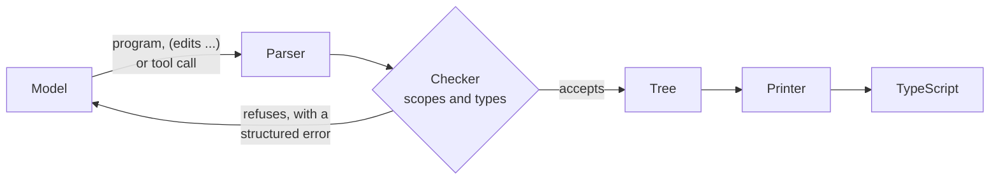

<div align="center">

<h1>Nodast</h1>

<p><strong>The model proposes nodes. A printer writes the code.</strong></p>

<p>A compact AST format for LLM code edits. The model edits a typed tree by node id,<br>
every edit is checked before it exists as text, and a deterministic printer writes the TypeScript.</p>

<p>
  <a href="https://github.com/R4F405/Nodast/actions/workflows/ci.yml"></a>
  <a href="LICENSE"></a>
  
  
  <a href="rust/"></a>
  <a href="https://github.com/R4F405/Nodast/labels/good%20first%20issue"></a>
</p>

<p>
  <a href="#quickstart">Quickstart</a> ·
  <a href="#how-it-works">How it works</a> ·
  <a href="#results">Results</a> ·
  <a href="#limits">Limits</a> ·
  <a href="#roadmap">Roadmap</a> ·
  <a href="#contributing">Contributing</a> ·
  <a href="README.es.md">Español</a>
</p>

</div>

<p align="center">
  <picture>
    <source media="(prefers-color-scheme: dark)" srcset="docs/demo.svg">
    <source media="(prefers-color-scheme: light)" srcset="docs/demo-light.svg">
    
  </picture>
  <br>
  <sub>Recorded from <code>pnpm demo</code>. It runs offline: no model, no API key.</sub>
</p>

## Why

Coding agents edit text. They either rewrite the whole file, which is slow and costly on large files, or find and replace strings, which goes wrong when names overlap (`rate` and `rate_cap`). Nothing stops an edit that does not type-check from landing on disk.

Nodast (**Node** + **AST**) gives the model a tree instead of a file:

- **Edit by node id.** The model sends `(edits (replace n9 50))` or a tool call, not the file again.
- **Checked before it is written.** A parser and a Hindley-Milner type checker refuse a bad edit with a structured error the model can act on. A refused edit changes nothing.
- **Structural operations.** `rename` follows scopes. `param` adds a parameter to a function and an argument to every call, in one edit.
- **One way out.** The model never writes the final source. A deterministic printer does.

> [!NOTE]
> **Measured with OpenAI `gpt-6.1-sol`, 5 runs per task:** accuracy equals plain text on every task. In a 500-line file, a one-node `(edits ...)` reply takes about 2 s; having the model rewrite the file takes 33 s. Against a fair text agent with `grep`, `read` and `replace`, a single local edit is a tie; scoped renames are where Nodast wins: 5/5 valid on the first try against 1/5 on the small case, and 1.5 to 2 times faster. [All the numbers](#results).

## Quickstart

You need **Node.js 22.18 or newer**, which runs TypeScript directly, so there is no build step.

```sh
git clone https://github.com/R4F405/Nodast.git
cd Nodast
node src/demo.ts                   # the session above: no install, no network, no key
node examples/check-and-print.ts   # parse, check, print, edit by id, see two refusals
node examples/model-loop.ts        # a refused reply goes back to the model and gets fixed
```

To run the tests and the type checker, install the two dev dependencies with [pnpm](https://pnpm.io) (the repo pins pnpm 11.5 in `packageManager`):

```sh
pnpm install
pnpm test                                   # no network, no key
pnpm typecheck
cargo test --manifest-path rust/Cargo.toml  # the Rust engine, with stable Rust
```

To call a real model, copy `.env.example` to `.env` and add a key. `pnpm ask -- "bind the sum of 1 and 2"` asks MiniMax for a program; `pnpm bench` runs the benchmark, against OpenAI by default.

## How it works



The model writes compact S-expressions:

```text
(let double (fn (n) (mul n 2)) (double 21))
```

The checker infers `number`, and the printer emits:

```ts
const double = (n) => n * 2;
double(21);
```

To edit, the model sees the tree with an id on every node, `n1:(let double n2:(fn (n) n3:(mul n4:n n5:2)) n6:(n7:double n8:21))`, and changes it in one of three ways:

| Way | What the model sends | Good for |
| --- | --- | --- |
| Write | One whole program | New code |
| Edit by id | `(edits (replace n8 50) (insert id index expr) (delete id))` | Programs small enough to show whole |
| Tools | `find`, `show` and `edit` through function calling | Large programs and structural changes |

`edit` can `replace`, `insert` or `delete` a node, `rename` a binding with all its uses, or add a `param` to a function and every call. The checker runs first, and the error goes back to the model when it refuses. An id the model has seen never comes back on a different node.

Types are inferred, so the model never writes annotations, and a function bound with `let` is generic. The same tree, parser, checker, printer, edits and a flat binary format also live in Rust, in [`rust/`](rust/); TypeScript is the behavior reference.

<details>
<summary><strong>Design decisions</strong>, not reopened in a pull request without an issue first</summary>

1. The model does not write the final source.
2. The model reads and writes compact text. JSON, hexadecimal and another compiler's AST are out of that contract.
3. The binary format is internal, after the checker, not something the model emits.
4. An edit changes nodes by id. The file is not rewritten.
5. Nothing reaches the printer without passing the checker.
6. One output language, TypeScript, until the loop from request to valid tree to code is solid.
7. No multiple source languages and no bytecode runner in this stage.

</details>

## Results

OpenAI `gpt-6.1-sol`, reasoning `low`, 5 runs per task. **Every variant reached the correct result in every run**, so the table compares time and tokens (input / output). The text agent works on the same TypeScript file with `grep`, `read` and `replace` (including replace-all), the way coding agents edit today.

| Task | Nodast, tools | Text agent, tools | Model rewrites the file |
| --- | ---: | ---: | ---: |
| Change one constant in a 500-line file | 4.6 s · 772 / 61 | **4.5 s · 581 / 67** | 32.8 s · 5559 / 5513 |
| Rename `rate` to `scale` next to `rate_cap`, 40 steps | **2.2 s**, 5/5 first try | 4.7 s, 1/5 first try | 4.7 s, 5/5 first try |
| Same rename, 400 steps | **4.4 s · 907 / 55** | 6.7 s · 1187 / 80 | 29.1 s · 4975 / 4927 |
| Add a parameter to a function called 200 times¹ | **9.1 s · 2182 / 136** | 13.7 s · 12045 / 174 | 35 s · 7432 / 5668 |
| Write a small program from scratch, 12 goals | 1.9 s · 23 out, 60/60 | — | 2.1 s · 25 out, 60/60 |

What it says:

- **A single local edit is a tie** with a good text agent. Editing in pieces is what saves tokens, and that agent edits in pieces too.
- **Changes that touch many places are where Nodast wins.** `rename` follows scopes, so it never touches `rate_cap`; the text agent tends to replace `rate` everywhere, break `rate_cap`, and fix it in a second call. `param` updates every call in one edit; the text agent has to reach each call.
- **Against rewriting the whole file, the gap is large.** Without tools, a one-node `(edits ...)` reply on the 500-line file takes 1.8 to 2.1 s and 15 output tokens, against 32.8 s and 5513; it reads the whole tree with ids, though, about twice the input tokens of the TypeScript.
- **Writing from scratch is a tie** with this model.

¹ Measured in a separate pass with the same setup; it is not in the report yet.

[BENCH.md](BENCH.md) summarizes every pass, **including MiniMax**, and [bench/openai.md](bench/openai.md) has the full OpenAI tables, with the id variants and every metric. `pnpm bench` reproduces them.

## Limits

- **The language is small on purpose:** numbers, booleans, `let`, pure functions, calls and `if`. No strings, lists or records yet, so it does not edit real-world code yet.
- **The benchmark is synthetic:** long chains of `let` and repeated calls, built to isolate one kind of edit at a time.
- **The format is not smaller than TypeScript.** The compact text is as large as the TypeScript or larger, and the tree with ids is almost twice its size. The savings come from editing pieces, not from the format.
- **Results depend on the model.** With MiniMax-M3, a weaker model, scoped renames and adding a parameter still go to Nodast (24 of 25 runs valid on the first try with tools, against 3 of 20 for the text agent), and a local edit in a 500-line file costs fewer tokens and less time than with the text agent; see [BENCH.md](BENCH.md). Claude as a provider is an [open issue](https://github.com/R4F405/Nodast/issues/11).
- **The text agent varies between runs.** In other passes the rename gap reached 2.8 times on cost and latency; the table shows the pass in the report.
- **Not a package yet.** Nodast is not on npm; the code is a proof of concept you run from the repository.

## Roadmap

Done: parser, checker, printer, id edits, model contract with retries, binary format, Rust engine, the `find`/`show`/`edit` tools, and the benchmark. Next, each with an issue you can pick up:

- Grow the language toward real programs: strings, lists, records ([#14](https://github.com/R4F405/Nodast/issues/14)).
- New structural operations, starting with extracting an expression into a `let` ([#13](https://github.com/R4F405/Nodast/issues/13)).
- Port the tool session to the Rust engine ([#12](https://github.com/R4F405/Nodast/issues/12)).
- More providers in the benchmark ([#11](https://github.com/R4F405/Nodast/issues/11)).

The detailed plan, with the reasoning behind each decision, is in [ROADMAP.md](ROADMAP.md) (in Spanish).

## Contributing

Contributions are welcome, in English or Spanish. Good places to start:

- [#9](https://github.com/R4F405/Nodast/issues/9): accept `index: -1` as "last" in `edit`. Small, in `src/tools.ts`, with tests.
- [#10](https://github.com/R4F405/Nodast/issues/10): choose which benchmark variants run with `BENCH_SIDES`. No API key needed to review.
- [#11](https://github.com/R4F405/Nodast/issues/11): add Claude as a benchmark provider.

Read [CONTRIBUTING.md](CONTRIBUTING.md) for the setup, the first-contribution path and more ideas. Questions and half-formed ideas go to [Discussions](https://github.com/R4F405/Nodast/discussions). By taking part you agree to the [Code of Conduct](CODE_OF_CONDUCT.md).

<details>
<summary><strong>FAQ</strong></summary>

**Isn't a good text agent enough?**
For a single local edit, yes: the benchmark shows a tie. Nodast helps where structure matters: renames that must respect scopes, signature changes that touch every call, and the guarantee that what lands on disk type-checks.

**Why S-expressions and not JSON?**
Fewer tokens and a small regular grammar. That grammar can also be checked one character at a time (`src/grammar.ts`), ready for a runtime that constrains decoding.

**Why not TypeScript's own AST?**
It is large and tied to one language. Nodast's tree is small enough to teach in a few prompt lines, its ids stay meaningful across edits, and the printer can target other languages later.

**Can I use it on my project today?**
Not yet. The language is still too small for real code. Today it is a working, measured proof of the idea, and the roadmap is about closing that gap.

</details>

## License

[MIT](LICENSE) © 2026 Rafa San Pablo González
