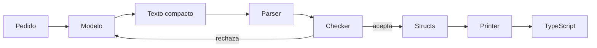

<p align="center">
  <strong>Nodast</strong><br>
  El modelo propone nodos. El printer escribe el código.
</p>

<p align="center">
  Árbol propio, validado antes de existir como texto.<br>
  Menos archivo reenviado, ediciones por nodo, una sola salida determinista.
</p>

<p align="center">
  <a href="ROADMAP.md">Roadmap</a> ·
  <a href="CONTRIBUTING.md">Contribuir</a> ·
  <a href="LICENSE">MIT</a>
</p>

---

**Estado.** PoC cerrado: parser, printer, checker, operaciones y contrato con el modelo.

Nodast (**Node** + **AST**) es una herramienta open source para generar y modificar código como un árbol, no como un archivo de texto. El modelo devuelve nodos o una operación sobre un nodo. Un checker acepta o rechaza el árbol. Un printer determinista es el único que produce el fuente.

## Qué problema trata

Pedirle a un modelo el archivo entero falla de formas concretas: la edición llega a medias, un nombre no existe, el tipo no cuadra, y el contexto se llena con el mismo código una y otra vez.

Nodast ataca esas tres:

| Problema | Qué hace Nodast |
| --- | --- |
| Archivo truncado o a medio editar | La mutación es `insert`, `replace` o `delete` sobre el id de un nodo |
| Programa inválido que ya se escribió a disco | El checker corre antes del printer |
| Contexto enorme | Viaja un parche y una forma corta del árbol, no el fuente repetido |

El corchete desbalanceado es el fallo barato. El checker existe para ámbito, tipos y forma. La sintaxis final no la elige el modelo.

## Cómo circula un programa



El mismo programa vive en tres sitios, y cada sitio tiene su formato:

| Capa | Formato | Para qué |
| --- | --- | --- |
| Hacia el modelo | Texto corto, tipo `(let x (add 1 2) x)` | Pocos tokens y una gramática regular |
| En memoria | Structs con id y tag | Recorrer, validar y aplicar operaciones |
| En disco, más adelante | Binario plano | Cargar un árbol grande sin volver a parsear |

`let x = 1 + 2 in x` se escribe así hacia el modelo:

```text
(let x (add 1 2) x)
```

El printer, con el árbol ya aceptado, emite TypeScript:

```ts
const x = 1 + 2;
x;
```

El tipo que describe los nodos vive en el código de Nodast. No viaja en el prompt ni se guarda como formato del programa.

## Qué entra en el primer PoC

Un lenguaje mínimo y cerrado:

- literales, `let`, funciones puras, llamadas, `if`
- aritmética y comparación
- tipos simples: `number`, `bool` y funciones
- operaciones `insert`, `replace` y `delete`
- un printer, a TypeScript
- un contrato de entrada y salida para el modelo, con un fixture para probar el círculo sin una API de pago
- un reintento cuando el checker devuelve un error estructurado

El proyecto del PoC se escribe en TypeScript. La IR no es el AST de TypeScript ni el de Rust: es el árbol de Nodast. Un motor en Rust puede leer ese mismo árbol después.

## Qué hay hoy

Parser, printer, checker, operaciones, el bucle con el modelo, el buffer binario y la gramática local del texto compacto. El mismo árbol, checker, printer y binario también están en Rust, en `rust/`. Los tests usan un fixture y no llaman a la red. El cliente real es MiniMax, con la clave fuera del repositorio. MiniMax no puede aplicar esa gramática al muestrear. El detalle está en el [roadmap](ROADMAP.md).

## Decisiones cerradas

Estas no se reabren en un pull request sin una issue que las discuta antes:

1. El modelo no escribe el fuente final.
2. Hacia el modelo va texto compacto. JSON, hexadecimal y un AST ajeno quedan fuera de ese contrato.
3. El binario es el formato interno de después de validar, no lo que el modelo emite.
4. Una operación cambia nodos por id. No se reescribe el archivo.
5. Nada llega al printer sin pasar el checker.
6. Un solo lenguaje de salida, TypeScript, hasta que pedido → árbol válido → código cierre.
7. El PoC no persigue varios lenguajes fuente ni un ejecutor de bytecode.

## Empezar

Hace falta Node 22.18 o superior, pnpm 11.5 y Rust. La versión de pnpm queda fijada en `packageManager`.

```sh
pnpm install
pnpm test
pnpm typecheck
cargo test --manifest-path rust/Cargo.toml
pnpm ask -- "bind the sum of 1 and 2"
```

`pnpm ask` lee `.env` y llama a MiniMax. `pnpm test` no.

`pnpm test` recorre parser, printer, checker, operaciones, el bucle del modelo, el binario y la gramática, sin red. `cargo test` recorre el motor en Rust. La forma de participar está en [CONTRIBUTING.md](CONTRIBUTING.md).

## Licencia

[MIT](LICENSE) © 2026 Rafa San Pablo González
