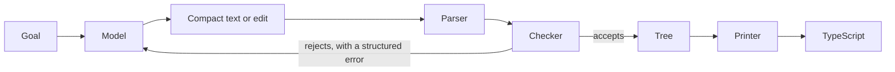

<p align="center">
  <strong>Nodast</strong><br>
  The model proposes nodes. A printer writes the code.
</p>

<p align="center">
  <a href="README.es.md">Español</a> ·
  <a href="bench/openai.md">Benchmark</a> ·
  <a href="ROADMAP.md">Roadmap</a> ·
  <a href="CONTRIBUTING.md">Contributing</a> ·
  <a href="LICENSE">MIT</a>
</p>

<p align="center">
  <a href="https://github.com/R4F405/Nodast/actions/workflows/ci.yml"></a>
</p>

---

Nodast (**Node** + **AST**) lets an LLM write and edit a program as a tree instead of a text file. The model sends short S-expressions or edits on node ids. A type checker accepts or rejects the tree before anything is written. A deterministic printer is the only thing that produces source code, TypeScript for now.

<p align="center">
  
</p>

That session runs offline with `pnpm demo`: no model, no key.

## Results

Measured with `gpt-6.1-sol` (OpenAI), 5 runs per task, all variants correct in every run. Nodast with tools is compared with a **fair text agent**: the same TypeScript file, with `grep`, `read` and `replace` (including replace-all), the way coding agents edit today. Cost uses the list price of 2 USD per million input tokens and 10 USD per million output tokens.

| Task | Nodast, tools | Text agent, tools | Model rewrites the file |
| --- | ---: | ---: | ---: |
| Rename `rate` to `scale` in 400 steps, next to `rate_cap` | **4.4 s**, 907 in / 55 out | 6.7 s, 1187 in / 80 out | 29 s, 4975 in / 4927 out |
| Add a parameter to a function called 200 times | **9.1 s**, 2182 in / 136 out | 13.7 s, 12045 in / 174 out | 35 s, 7432 in / 5668 out |
| Change one constant in a 500-line file | 4.6 s, 772 in / 61 out | 4.5 s, **581 in** / 67 out | 33 s, 5559 in / 5513 out |
| Write a small program from scratch | 1.9 s, 23 out, 60/60 first try | — | 2.1 s, 25 out, 60/60 first try |

What this says:

- **Changes that touch many places are where Nodast wins.** `rename` follows scopes, so it never touches `rate_cap`; the text agent tends to replace `rate` everywhere, break `rate_cap` and fix it back. `param` adds the parameter and updates every call in one edit; the text agent has to reach each call, since each has its own argument. Adding a parameter at 200 call sites costs about 4.5 times less with Nodast.
- **A single local edit is a tie.** Editing in pieces is what saves tokens, and a text agent with good tools does that too. Nodast's fixed prompt is slightly larger.
- **Against rewriting the whole file, Nodast wins by far:** 12 to 30 times cheaper and up to 7 times faster.

The full tables, with the other variants and every metric, are in [bench/openai.md](bench/openai.md). `pnpm bench` reproduces them. The parameter task was measured in a separate pass with the same setup and is not in that report yet.

## Limits, honestly

- **The language is small on purpose:** numbers, bools, `let`, pure functions, calls, `if`. No strings, lists or records yet, so no real-world programs yet.
- **The benchmark is synthetic:** long chains of `let` and repeated calls, built to isolate one kind of edit at a time.
- **One strong model measured so far.** MiniMax was used during development; results on other vendors are an [open issue](https://github.com/R4F405/Nodast/issues/11).
- **The text agent varies between runs.** In other passes the rename gap reached 2.8 times on cost and latency; the table shows the pass in the report.

## How it works



The model writes compact text:

```text
(let x (add 1 2) x)
```

and the printer emits:

```ts
const x = 1 + 2;
x;
```

When editing, every node carries an id, like `n4:(add n5:v0 n6:7)`, and the model works through three tools:

| Tool | What it does |
| --- | --- |
| `find` | Finds nodes by exact text, kind or name. Returns ids and a short view. |
| `show` | Shows a node and its children to a depth. |
| `edit` | `replace`, `insert` or `delete` a node, `rename` a binding with all its uses, or add a `param` to a function and every call. The checker runs first; a rejected edit changes nothing. |

Types are inferred with Hindley-Milner, so the model never writes annotations, and a function bound with `let` is generic. The same tree, parser, checker, printer and binary format also live in Rust, in [`rust/`](rust/); TypeScript is the behavior reference.

## Quick start

Node 22.18+, pnpm 11.5 and, for `rust/`, stable Rust.

```sh
pnpm install
pnpm demo     # an offline tool session
pnpm test     # no network, no key
```

`cargo test --manifest-path rust/Cargo.toml` runs the Rust engine. `pnpm ask -- "bind the sum of 1 and 2"` and `pnpm bench` call a real model and read a key from `.env`; see `.env.example`.

## Contributing

Start with an issue labeled [good first issue](https://github.com/R4F405/Nodast/labels/good%20first%20issue), or a [proposal](https://github.com/R4F405/Nodast/labels/proposal) to grow the language or add structural edits. Read [CONTRIBUTING.md](CONTRIBUTING.md) first. Issues and pull requests can be in English or Spanish.

## License

[MIT](LICENSE) © 2026 Rafa San Pablo González
